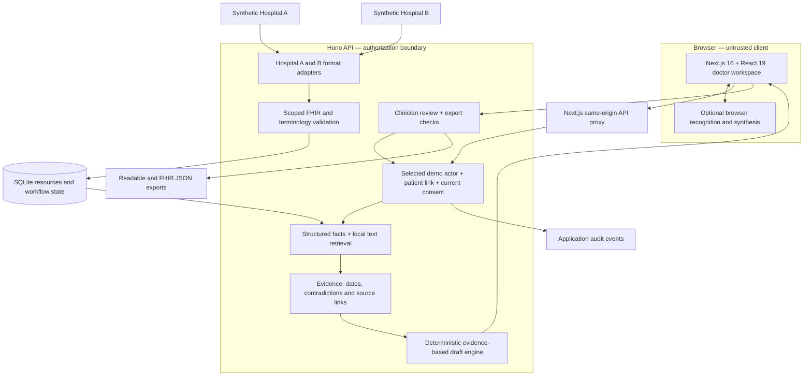
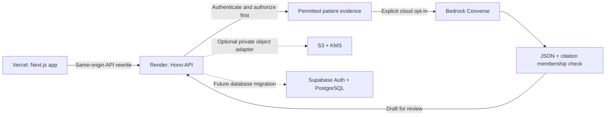
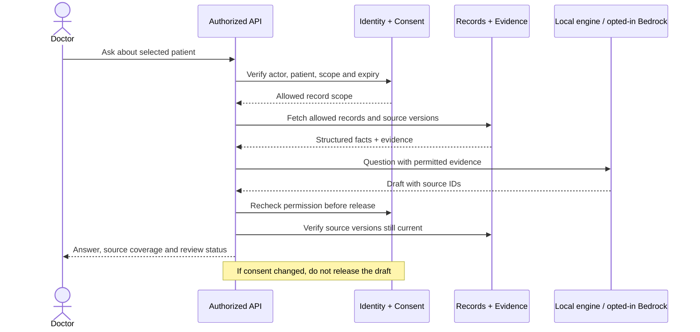

# Clinical workspace architecture

This is a PS-013 synthetic-data prototype. Its working local path uses two simulated hospital datasets, a Node API and SQLite. Cloud adapters are optional code, not connected services. No real hospital, ABDM production gateway, insurer, Supabase project or AWS account has been connected.

## Working local path

Every record, summary, chat and export API must check current permission. Hiding a button does not enforce consent. Sources unavailable or denied remain explicitly unavailable; absent records do not become negative clinical findings.

## Optional cloud path

The Next.js app serves the presentation at `/` and the clinical interface at `/workspace`. It proxies `/api` through a configured backend origin, keeping the browser session on the same origin. Its visual layer follows the latest brand PDF: white `#FFFFFF`, ink `#111111`, orange-red `#FF5B3E`, yellow `#FFD84D`, borders `#DEDEDE`, Space Grotesk headings and DM Sans text. Kalam is reserved for one small handwritten landing annotation. Motion/3D libraries do not participate in clinical reasoning or permissions. See the [design brief](design-brief.md) for reference interpretation and interaction requirements.

The LLM has no database credentials or tools. It receives evidence already filtered by the backend. The adapter treats source text as untrusted, requires explicit output-token limits, rejects malformed or unknown citations and does not silently substitute a successful local answer after a cloud error. These checks establish response shape and provenance membership; they do not prove every medical statement is correct.

## Seven user capabilities

| Capability | Implementation responsibility |
|---|---|
| Convert records into FHIR | Explicit A/B adapters with a reviewed mapping allowlist; preserve originals and report unsupported mappings. |
| Match patient identity | Identifier and demographic evidence; uncertain links require review. Names alone do not merge patients. |
| Authorize sharing | Current actor, recipient institution, purpose, category and expiry checked server-side; audit access. |
| Read a sourced summary | Structured facts plus supporting report excerpts, clinical dates and available-source coverage. |
| Inspect changes and conflicts | Deterministic comparisons only for compatible supported observations; unresolved contradictory statements remain separate. |
| Ask by text or voice | One authorized chat endpoint; local browser speech can input and read answers where the browser supports it. |
| Review and export | Approve a version, validate supported FHIR structure, recheck consent and source versions before export. |

## Boundaries that must remain visible

- **Authentication:** demo actor selection is not production authentication. Replace it with validated Supabase JWTs and institution membership before any real data or public access.
- **FHIR:** the prototype performs scoped checks for its synthetic resource shapes. A full server, NRCeS profile/terminology validator and conformance tests are still required for an ABDM integration or certification claim.
- **Retrieval:** the default local engine uses structured facts and lexical relevance, not hosted embeddings or managed GraphRAG. Evidence graph edges are explicit application relationships.
- **Voice:** browser recognition may send microphone audio to the browser vendor. Availability depends on browser and permissions. Nova Sonic streaming is a future integration, not implemented by the Bedrock text adapter.
- **Encryption:** localhost development is HTTP and SQLite is not transparently encrypted by this app. Production TLS, database/storage encryption and key management must be configured and tested.
- **Revocation:** future reads and exports can be denied. Prior downloads and previously heard audio cannot be erased remotely.
- **Audit:** application events are demo audit records. Production requires protected, append-only retention and separate infrastructure audit logs.

## Request and revocation sequence

## Research references

Official documentation consulted on 15 October 2026:

- [React releases](https://react.dev/versions), [Next.js configuration](https://nextjs.org/docs/app/api-reference/config/next-config-js) and [Next.js rewrites](https://nextjs.org/docs/app/api-reference/config/next-config-js/rewrites).
- [Node.js release schedule](https://nodejs.org/en/about/previous-releases) and [Node SQLite API](https://nodejs.org/api/sqlite.html).
- [Hono Node deployment](https://hono.dev/docs/getting-started/nodejs).
- [Bedrock Converse](https://docs.aws.amazon.com/bedrock/latest/APIReference/API_runtime_Converse.html).
- [Supabase row-level security](https://supabase.com/docs/guides/database/postgres/row-level-security).
- [Next.js on Vercel](https://vercel.com/docs/frameworks/full-stack/nextjs) and [Render persistent disks](https://render.com/docs/disks).
- [FHIR R4 validation](https://hl7.org/fhir/R4/validation.html) and [NRCeS ABDM implementation guide](https://www.nrces.in/ndhm/fhir/r4/).
